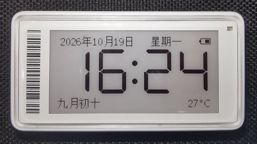
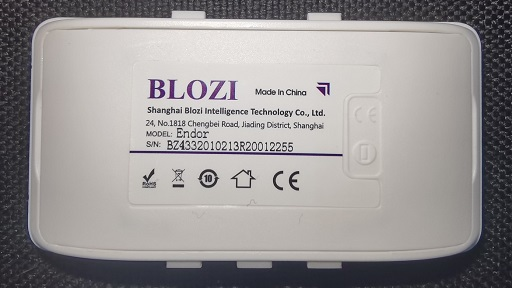
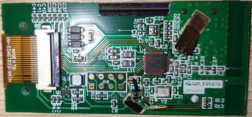

# CCLOCK

基于CC2640R2F的电子价签的时钟固件。   
目前只适配了保资某款2.13寸黑白红型号。
功能与使用可参考我的HMCLOCK项目。   
因为CC2640这颗芯片资源太紧张，此固件无在线更新功能。   

## GPIO定义
| GPIO | 功能 | 备注 |
| ---- | ---- | ---- |
| P00 | Txd |     用作调试串口输出 |
| P01 |  --- |
| P02 |  --- |
| P03 |  --- |
| P04 |  --- | P00-P04用于NFC芯片，当前未使用 |
| P05 |  MOSI |
| P06 |  SCLK |
| P07 |  SCS |
| P08 |  DC |
| P09 |  RST |
| P10 |  BUSY |
| P11 |  --- |
| P12 |  BLUE |
| P13 |  RED |
| P14 |  --- |

## 调试接口定义

| PAD | 功能 | 功能 | PAD |
| ---- | ---- | ---- | ---- |
| 1 | GND | VCC  | 2 |
| 3 | TCK | TMS  | 4 |
| 5 | NC  | VBAT | 6 |
| 7 | RST | NC   | 8 |

## 编译
使用CCS21.0.0环境编译。   
SDK的版本是simplelink_cc2640r2_sdk_5_30_00_03   
使用Import功能将两个目录导入后编译即可。

## 烧录
需要支持cJTAG的调试器，比如TI自己的XDS系列，或者新版本的jlink。推荐使用JLinkOB。
如果想使用4线JTAG, 需要额外飞两根线。
CCS可能会提示烧写失败。此时可用JFlash工具手动擦除Flash的最后一块即可。
